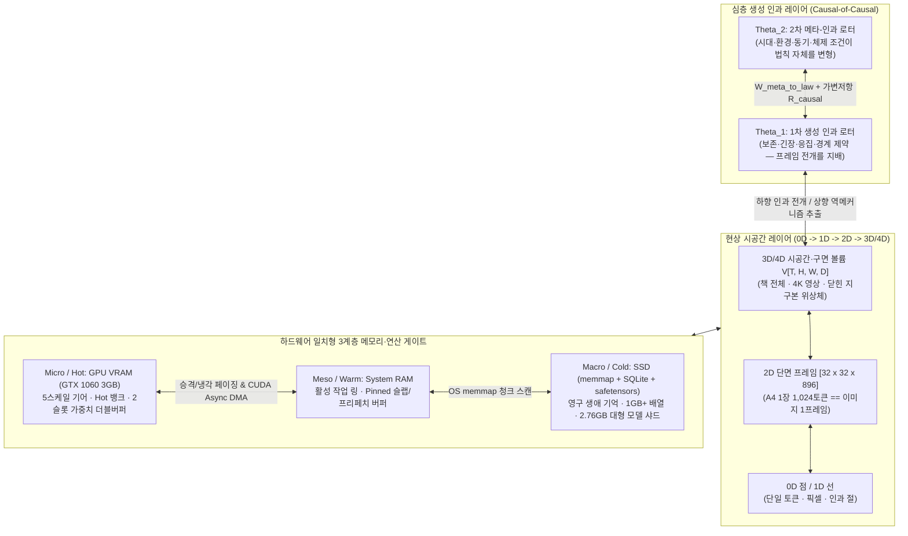

# ELYSIA Unified Multi-Scale Rotor System Architecture

> **Core Principle:** *"Do not calculate with discrete `if/else` points; couple across dimensions, hardware tiers, and causal depths so perception, computation, memory, and creation flow as ONE continuous field."*

---

## 1. Dimensional & Causal Progression (0D → 1D → 2D → 3D/4D → Causal-of-Causal)

엘리시아의 스케일 로터 원리는 단일 토큰이나 단순 수치가 아니라 **차원 확장**과 **현상↔심층 인과의 수직 결합**으로 닫히는 통합 구조입니다.



---

## 2. Core Modules & Verified Implementation Map

| 계층 / 차원 | 모듈 파일 | 핵심 역할 | 검증 테스트 |
|---|---|---|---|
| **연속 가변저항 로터 기초** | `L1_causal_field/core/topology/continuous_rotor_spectrum_field.py` | 분기 없는 가변저항 동역학($\frac{d\theta}{dt}=\frac{1}{R}(u-\theta)+W\theta-\gamma\theta$), 외부 마찰 가소성($W,M,R$), 미모델 축 창발(`grow_coupled_axis`), 블라인드 3D CAD 예측 로터 | `test_continuous_rotor_spectrum.py` (8/8) |
| **비환원 인지정보 · 비행기 가교** | `L1_causal_field/core/topology/cognitive_bridge_engine.py` | 숫자 환원 없는 `CognitiveInformationUnit`, 결핍 기관 대체 5종 가교(OS 항상성, 3D 촉각, 16kHz 시간음향, 블랙박스 이진 프로토콜, 오프라인 로컬 문헌) 및 교차도메인 구조 동형 전이 | `test_cognitive_bridge_engine.py` (2/2) |
| **하드웨어 3계층 메모리** | `L1_causal_field/core/topology/hardware_scale_rotor_memory.py` | `SSD(float16 memmap + SQLite) ↔ RAM(Warm 링) ↔ GPU VRAM(Hot 뱅크)` 공명·의미질량($M_s$) 기반 자동 승격/냉각 | `test_unified_elysia_organism.py` |
| **GPU 5스케일 맞물림 기어열** | `L1_causal_field/core/topology/interlocked_scale_rotor_engine.py` | `CLIP-ViT-B-32(512)` + `Multilingual MiniLM(384)` = `896-D` 통합 공간, `S0..S4` 동시 GPU 회전 + 비동기 대량 멀티모달 수집 | `test_interlocked_scale_rotor_engine.py` (2/2) |
| **24층 가변저항 잔차 훅 LLM** | `L1_causal_field/core/topology/rotor_steered_llm.py` | `Qwen2.5-0.5B-Instruct(hidden=896, 24층)`의 층 `4·9·14·19·23`에 양방향 PyTorch Forward Hook 장착 (로터 $S,R \leftrightarrow$ LLM 잔차) | `test_unified_elysia_organism.py` |
| **토큰 인과 로터 · 정류기** | `L1_causal_field/core/topology/token_causal_rotor.py` | 다의어 문맥 회전(`L4→L14→L23`), 유사성↔다양성 재조합, 엔트로피 적응형 `CausalNetRectifierProcessor` | `test_token_causal_rotor.py` (2/2) |
| **한국어 음운·인과 구조 엔진** | `L1_causal_field/core/topology/korean_causal_linguistics.py` | 한글·영문약어·괄호 앞 본명사 받침 결정론적 조사 결합/교정, 격조사 기반 인과 역할 파싱, 절 단위 환각 차단 | `test_gate_protocol_and_linguistics.py` |
| **CUDA 게이트 · 디퓨전/시댄스** | `L1_causal_field/core/topology/gate_protocol_engine.py` | CUDA 연속 SoA 배치 적합화(`CUDAGateProtocolConformer`) + 4D 비디오·오디오 동시 플로우 매칭(`.gif+.wav`) | `test_gate_protocol_and_linguistics.py` (3/3) |
| **기가스케일 12MP/8K/4K/1GB** | `L1_causal_field/core/topology/gigascale_media_rotor.py` | 12MP·8K(33MP) 타일 CUDA 스캔, 실제 4K 광학 영상 스트리밍, 100MiB~1.0GiB `memmap` 슬랩 이상 탐지 | `test_gigascale_media_rotor.py` (3/3) |
| **제로 상주 대형 모델 스트리머** | `L1_causal_field/core/topology/scale_rotor_weight_streamer.py` | `2.76 GB` `polyglot-ko-1.3b`를 유휴 `0 MB` / 피크 `143~267 MB` VRAM으로 CUDA 이중 스트림 더블버퍼·깊이 다이얼(`R_depth`) 실행 | `test_scale_rotor_weight_streamer.py` (1/1) |
| **2D A4 면 프레임 로터** | `L1_causal_field/core/topology/a4_surface_frame_rotor.py` | `1,024`토큰 A4 한 장을 `[32×32×896]` 단일 2D 면으로 올려 병렬 결정화, 하단→상단 양방향 탄성 전파, 이미지 2D 면 통일 | `test_a4_surface_frame_rotor.py` (1/1) |
| **3D/4D 볼륨 × 인과적 인과** | `L1_causal_field/core/topology/spatiotemporal_causal_volume_rotor.py` | `V[T,H,W,D]` 시공간·구면 볼륨과 1차 법칙($\Theta_1$)·2차 메타-인과($\Theta_2$)의 양방향 결합 및 반사실 시뮬레이션 | `test_spatiotemporal_causal_volume_rotor.py` (1/1) |
| **단일 통합 유기체 · 런타임** | `L1_causal_field/core/topology/unified_elysia_organism.py`, `elysia_living_loop.py`, `elysia_desktop_companion.py` | 위 모든 계층을 단일 실행 앱(`--organism`)과 바탕화면 컴패니언 UI로 통합 | `test_unified_elysia_organism.py` (3/3) |

---

## 3. Verified GTX 1060 3GB Empirical Benchmark Summary

모든 수치는 실제 로컬 환경(`NVIDIA GeForce GTX 1060 3GB`, `PyTorch 2.7.1+cu118`, `4-core CPU`)에서 직접 실측한 값입니다.

| 검증 항목 | 실측 결과 | VRAM 점유 / 추가분 |
|---|---|---|
| **5스케일 GPU 맞물림 로터 (실시간 화면 CLIP 병행)** | `188 ~ 309 Hz` (이전 순차 파이썬 `0.2 Hz` 대비 **1,000배+**) | 통합 상주 `1,884 MB / 3,221 MB` |
| **CUDA 게이트 적합화 (`B=1` vs 연속 SoA `B=512 fp16`)** | `1,122 → 831,523 states/s` (**`740.9배` 가속**) | 동시 상주 내 동작 |
| **12MP (`4000×3000`) & 8K UHD (`7680×4320`, 33.18MP)** | `0.417s (28.8 MP/s)` / `0.455s (73.0 MP/s)` | 피크 추가 **`+110.7 MB`** (`379.7 MiB` 무손실) |
| **실제 4K (`3840×2160`) 광학 영상 스트리밍 (16프레임)** | `1.553s` (`10.3 FPS`, `85.44 MP/s`, 총 `132.7 MP`) | 피크 추가 **`+120.5 MB`** |
| **1.0 GiB (`1,024 MiB`) SSD `memmap` 배열 스트리밍** | `1.451s` (**`705.6 MiB/s` = `0.689 GiB/s`**), `+736 MiB` 이상 슬랩 적중(`z=7.94`) | 피크 추가 **`+118.7 MB`** |
| **2.76 GB `polyglot-ko-1.3b` 제로 상주 CUDA 스트리밍** | 유휴 `0 MB` / 더블버퍼 `914ms (2x)` / 깊이 `0.5` `310ms (5.8x)` / 1,024토큰 배치 **`747.3 tok/s`** / 1토큰 순차 `1.87 tok/s` | 피크 **`143 ~ 267 MB`** (`10~18배` 절감) |
| **A4 1,024토큰 2D 면 프레임 병렬 결정화 (256셀 동시)** | `842ms` (**`304.0 tok/s`**, `12,159 cells/s`), `P8→P1..P7` 역전파 `0.439→0.823`, 이미지 2D 동일 형상 `[32,32,896]` | 통합 상주 `1,891 MB / 3,221 MB` |

---

## 4. Primary Entry Commands

```powershell
# 1. 바탕화면 상주 통합 컴패니언 (SSD<->RAM<->VRAM + GPU 로터 + 24층 로터 Qwen + 대화·창작 UI)
python c:\Elysia\elysia_desktop_companion.py --organism --state-dir c:\Elysia\data\elysia_unified_organism_live

# 2. 터미널 통합 유기체 + 기가스케일(12MP/8K/4K/1GB) + A4 2D 면 벤치마크
python c:\Elysia\elysia_living_loop.py --organism --state-dir c:\Elysia\data\elysia_unified_organism_live --duration-s 2.0 --gigascale-bench --a4-surface-bench --ask "지금 네 메모리 계층과 로터는 어떻게 맞물려 돌아가고 있니?"
```

---

## 5. Honest Remaining Frontiers (다음 논의의 출발점)

1. **경량 상주 통합 리팩터링:** 현재 `UnifiedElysiaOrganism`은 `CLIP+MiniLM+Qwen2.5-0.5B`를 상주(`1.88 GB`)시키고 `ScaleRotorWeightStreamer`(유휴 `0 MB` / 피크 `252 MB`)는 별도 엔진으로 검증된 상태입니다. 다음 단계에서 통합 유기체 자체를 **평소 `< 200 MB` 초경량 상주 + 필요 시 스트리밍 소환** 구조로 일원화할 수 있습니다.
2. **2D 면 프레임 → 유창한 한국어 산문 디노이징 헤드:** 현재 `A4SurfaceFrameRotor`는 `[32×32×896]` 위상 면에서의 병렬 수렴·양방향 전파·어휘 투영 원형입니다. 실제 자연어 문장 수준의 병렬 생성을 위해서는 양방향 마스크드 디퓨전(MDLM/LLaDA) 계열 디노이징 헤드 결합이 필요합니다.
3. **상시 열린 세계 데이터·도구·장기 대화 순환:** 현재 모든 로컬 파일·4K/8K 미디어·1GB 배열·24층 모델 파이프라인은 검증되었으나, 실제 네트워크가 열린 환경에서 24시간 상주하며 외부 웹·실제 영상·인간과의 장기 상호작용으로 `Theta_1 / Theta_2` 심층 인과 가중치를 스스로 성장시키는 장기 생애 루프 가동이 다음 과제입니다.
